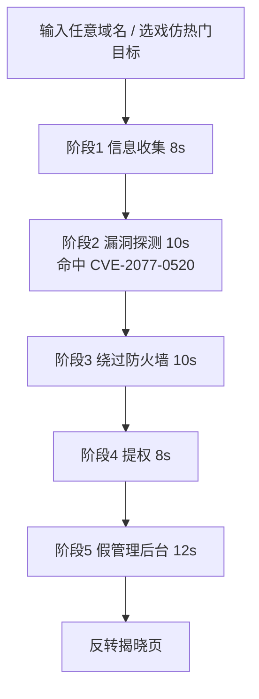
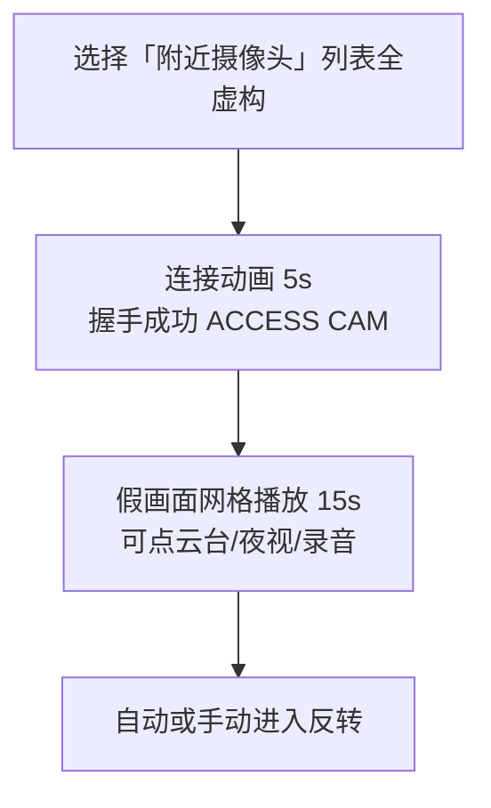
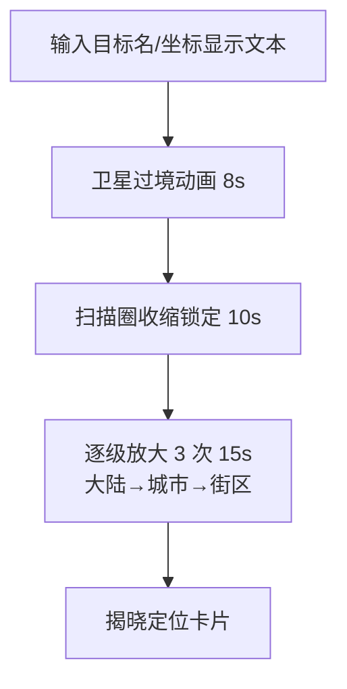
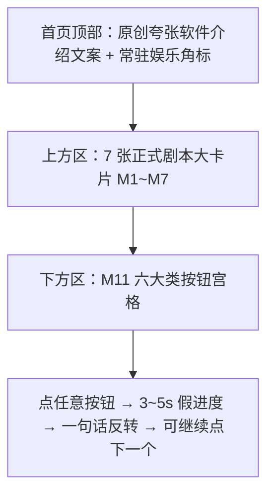

# 「黑客工具箱·搞怪版」产品需求文档（PRD）

| 项目 | 内容 |
|---|---|
| 文档版本 | v0.5（真实感改版：外观照真工具，效果全模拟） |
| 工作名 | `hacker-toolbox-prank`（正式品牌名与域名待定） |
| 日期 | 2026-10-17 |
| 负责人 | Tiger |
| 产品形态 | 第一版为**纯前端静态网页**，部署于 **Cloudflare Pages** |
| 一句话定义 | 看起来像电影里的黑客神器，其实什么都不做的整蛊/娱乐模拟器 |

> 注：文中「黑客工具箱·搞怪版」为描述性称呼，非最终品牌名。

> ⚠️ **三条底线（不可妥协）**
> 1. **全部本地模拟**：所有"扫描、破解、入侵、追踪、加密"都是本地动画与随机/虚构文本。
> 2. **零真实请求**：不对用户输入的任何目标发起 DNS / HTTP / ping / WebSocket 等请求；运行时也不请求任何第三方资源。
> 3. **常驻『纯属娱乐，所有内容均为模拟』标识**：任何页面、任何模式（含全屏、整蛊弹窗、截图）都可见，不可关闭。

### 修订记录

| 版本 | 日期 | 变更 |
|---|---|---|
| v0.1 | 2026-10-17 | 初稿（MVP 4 个模块） |
| v0.2 | 2026-10-17 | ① 明确第一版纯前端 + Cloudflare Pages 部署；② MVP 扩至 10 个假工具模块，新增摄像头接管、卫星追踪、勒索弹窗整蛊等必含模块；③ 每个模块补齐交互流程、优先级与结尾反转；④ 关闭已决议的开放问题 |
| v0.3 | 2026-10-17 | 总负责人拍板：① 9:16 竖屏导出进 P1（新增 G9）；② 勒索弹窗默认温和，电影级为可选开关，任何模式可一键关闭、不劫持浏览器；③ v1 不做任何统计，保持零请求；④ 赞助仅用普通 `<a>` 外链，不嵌第三方脚本/图片；⑤ 暂用工作名 `hacker-toolbox-prank`，品牌名/域名待定；⑥ 新增 §2.9 命名规则（用户自填目标、剧本恶搞名、CVE-2077-xxxx）与彩蛋结构化写法 `{trigger, match, output}`；开放问题收敛为 1 条 |
| v0.4 | 2026-10-17 | 新增 M11「一键神功」按钮墙（首页：7 张正式剧本大卡片 + 六大类小按钮宫格），灵感来源 GodOfHacker（WWILLV）仅借创意、不借代码/图片、不照搬文案；首页改用原创夸张软件介绍风；按钮点击跑 3–5s 假进度 + 一句话反转（自有卡 99% 梗，stall 可填任意两位数）；第一批 20 个按钮 P0、扩到 40+ 为 P1；按钮字段 `{id, category, label, duration, stall?, twist, logs?, steps?}`，category 枚举 site/crack/ctf/wireless/hardware/mystic，页面显示名采用 Kali 菜单式叫法（Web 应用分析 / 密码攻击 / 漏洞利用 / 无线攻击 / 硬件与物联网 / 信息收集）；强化「纯属娱乐」标识的字号、对比度与层级要求，并要求结尾反转再次声明；新增审核红线（禁隐私/偷窥/骚扰/低俗/财产犯罪暗示、禁任何真实外链或请求、禁与原作雷同或近似改写，测试逐条比对）；「关于」页纯文字致谢灵感来源 |
| v0.5 | 2026-10-17 | 真实感改版：新增 §0「第一原则」（外观照真工具，效果全模拟，笑点只留结尾反转）；终端输出仿 nmap / hydra / sqlmap / msfconsole / aircrack-ng 真实格式（工具名仅作显示白名单），Kali 风终端 UI；过程文案写实、不插随机梗、中途不加「（模拟）」标记，披露只在结尾反转弹窗；终端首行命令可展示但不可选中/复制，其余不出现完整可运行命令；CVE 仅 `^CVE-2077-\d{4}$`、IP 仅文档段、目标虚构；分类显示名定稿为 Kali 菜单式（`src/gags.categories.ts` 为唯一来源）；信息收集（mystic）条目全部改写为写实侦察项，删除玄学/运势梗；『纯属娱乐』标识常驻、桌面 ≥14px / 移动 ≥12px、对比度 ≥4.5:1、不被遮挡、不挪到角落状态栏；保持 Logo 彩蛋 5 连击、v1 零统计、赞助普通 `<a>`（关于页与反转页）、9:16 导出 P1 |

---

## 0. 第一原则：外观照真工具，效果全模拟，笑点只留结尾反转

> 本节为 v0.5 总纲，优先级高于后续具体文案；与 §2 红线冲突时以更严格者为准。

1. **外观照真工具**：终端输出模仿真实安全工具的输出*格式*——`nmap`（端口/服务扫描）、`hydra`（登录爆破）、`sqlmap` / `msfconsole`（漏洞利用会话）、`aircrack-ng`（无线握手破解）。工具名**仅作显示用途**，列入只读白名单（见下），不实现、不链接、不教学任何真实功能。
2. **效果全模拟**：零真实请求（§2.1）不变，所有输出均为本地生成的写实占位文本。
3. **笑点只留结尾反转**：过程文案**写实、克制、不插随机梗**；中途**不出现**「（模拟）」「（simulated）」「（假的）」之类标记；全部披露集中在**结尾反转弹窗**里，短，明确重申「刚才所有内容均为模拟，未发出任何真实请求」。
4. **Kali 风终端 UI**：深色终端、等宽字体、提示符（如 `┌──(kali㉿kali)-[~]` / `└─$`）、滚动伪日志、进度条/旋转符，营造真实命令行观感。

### 0.1 终端命令行展示规则（重要）
- **首行命令可作为例外展示**：每个剧本终端允许显示**一行**起始命令，用于营造真实感，例如：
  `nmap -sS -sV -O -T4 -p- 192.0.2.47`
- 该命令行必须 **不可选中、不可复制**：`user-select: none`，并拦截 `copy` / `cut` / `contextmenu` 事件；长按、框选、右键复制均无效。
- 命令中的目标**只能是文档/保留段 IP**（`192.0.2.0/24`、`198.51.100.0/24`、`203.0.113.0/24`）或虚构域名，绝不出现真实目标。
- **除这一行外，终端不得出现任何完整、可运行、可复制的命令**；后续输出只呈现「结果」格式，不呈现可照抄的命令序列或参数组合。
- **剧本文案中的 nmap 脚本为唯一参考样例**：其格式、字段、节奏作为写实输出的基准，其他模块比照它编写。

### 0.2 命名与数据约束（承接 §2.4 / §2.6）
- CVE 编号一律匹配 `^CVE-2077-\d{4}$`。
- IP 仅用文档段（`192.0.2.0/24`、`198.51.100.0/24`、`203.0.113.0/24`）。
- 目标（域名、主机名、机构）一律虚构。

### 0.3 工具名显示白名单（只读、display-only）
`nmap`、`hydra`、`sqlmap`、`msfconsole`、`aircrack-ng`。仅用于终端输出的观感，不得链接官网、不附下载、不讲参数含义或真实用法。

### 0.4 安全提示的位置
- 「不锁屏、不加密」等安全/免责提示在 **UI 层**（角标、说明条、反转弹窗）展示，**不写进终端输出正文**，以免破坏终端的写实观感。

---

## 1. 产品定位与目标用户 / 场景


### 1.1 定位
"演技派"假黑客模拟器：界面与流程模仿市面黑客工具和影视黑客场景（终端绿字、进度条、滚动日志、地图连线、监控网格），视觉足够逼真以"唬人"；每个流程最终都以搞怪反转揭晓"你被骗啦"，把紧张感转化为笑点。

### 1.2 目标用户

| 用户 | 画像 | 核心诉求 |
|---|---|---|
| 整蛊型 | 学生、上班族 | 让朋友以为"电脑被黑了 / 我是黑客"，然后一起笑 |
| 内容创作者 | 抖音 / B 站 / 快手 / 小红书博主 | 逼真的"黑客画面"素材，可竖屏、可录屏 |
| 装 X 型 | 网吧、教室、办公室 | 全屏运行，看起来在敲高深代码 |
| 技术圈玩梗 | 程序员、安全从业者 | 欣赏梗和彩蛋，转发到群里 |

### 1.3 典型场景
1. **整蛊朋友**：趁朋友离开，在其浏览器打开「勒索弹窗整蛊」或「摄像头接管」，朋友回来吓一跳 → 几秒后反转"你被骗啦🤡"。
2. **拍短视频**：输入"某大厂官网"，跑「入侵网站拿后台」，录下 45 秒绿字 + ACCESS GRANTED，结尾反转。
3. **装 X**：全屏「黑客打字机」，乱敲键盘输出专业感伪代码。
4. **聚会 / 直播**：投屏「卫星追踪」或「DDoS 面板」，观众喊目标，结局搞笑。

### 1.4 非目标
- 不做任何真实安全工具、教学、靶场、CTF。
- 不做真实恐吓 / 勒索 / 诈骗诱导（付款、拨号、下载、输入账号密码）。
- 第一版不做账号、后端、排行榜、评论、广告。

---

## 2. 合规与安全红线

### 2.1 零真实网络请求
- **R1 零目标请求**：用户输入的域名 / IP / URL / WiFi 名 / 手机号 / 地址等**只作为显示文本**，不做 DNS 解析、HTTP(S)、WebSocket、WebRTC、ping、``/favicon 预取、`fetch`、`sendBeacon`，不转为可点击链接。
- **R2 零第三方请求**：字体、音效、视频素材、世界地图矢量数据、图标全部随静态包本地打包；不接 CDN、统计、广告、地图瓦片服务。
- **R3 技术兜底**：
  - Cloudflare Pages `_headers` 下发 CSP：`default-src 'self'; connect-src 'none'; img-src 'self' data: blob:; media-src 'self' blob:; font-src 'self'; frame-src 'none'; form-action 'none'; base-uri 'self'`。
  - 页面 `<meta http-equiv="Content-Security-Policy">` 同等策略兜底。
  - 禁用 `dns-prefetch / preconnect / prefetch`。
  - CI E2E（Playwright）跑完全部 MVP 模块，断言**除同源静态资源外请求数为 0**。

### 2.2 不调用敏感设备能力
- **R4**：全站不调用 `getUserMedia`、`enumerateDevices`、`navigator.permissions.query`、Geolocation、Clipboard 读取、File System Access、Bluetooth/USB/Serial、Notification 权限请求。**任何时刻都不能弹出浏览器权限框。**
- CI 静态扫描：源码出现上述 API 名即构建失败。

### 2.3 不教授真实攻击技术
- **R5**：所有"命令/代码/日志"为无可执行意义的伪代码或梗文本（如 `inject --banana-mode=extreme`、`bypass firewall... using 3 cups of coffee`）；禁止真实 payload、exploit、真实工具有效参数组合。
- **R6**：日志文本库上线前人工评审；CI 词表 lint 拦截黑名单。
- **R7**：无教程、原理讲解或"怎么做成真的"引导。

### 2.4 不用真实漏洞名误导
- **R8**：禁止真实 CVE 编号、真实漏洞名（Heartbleed、Log4Shell、EternalBlue 等）、真实恶意软件 / 勒索家族名、真实黑客组织名。
- **R9**：使用明显虚构名：漏洞编号统一 `CVE-2077-` + 4 位数字（如 `CVE-2077-0520`、`CVE-2077-1145`）、"薛定谔溢出漏洞""午睡提权漏洞""奶茶注入（MilkTea Injection）"。

### 2.5 不收集用户数据
- **R10**：无后端、无埋点、无 Cookie、无指纹；设置项（音效、主题）仅存 `localStorage`，可一键清除。
- **R11**：用户输入不持久化（刷新即清），不上传；截图 / 录屏本地生成。
- **R12 v1 零统计**：v1 不做任何统计（含自托管 PV、错误上报、性能上报），保持运行时零请求；统计以后再议，届时需单独评审。
- **R12a**：Cloudflare 侧关闭 Web Analytics 自动注入、Zaraz、Rocket Loader、Email Obfuscation 等会注入脚本的功能（见 §7.1）。

### 2.6 虚构数据声明
- **R13**：所有"目标数据"均为随机生成或虚构：
  - IP 只用文档 / 保留段（`192.0.2.0/24`、`198.51.100.0/24`、`203.0.113.0/24`、`10.x`）或梗值（`127.0.0.1`"你自己家"）。
  - 账号密码为梗文本（`admin / 123456`），不生成像真实泄露数据的内容。
  - 人名、地址、手机号明显虚构（"张三""火星市银河区 404 号""138-0000-0000"）。
  - 摄像头画面为预置素材 / 程序生成，不含可识别真实人物或真实地点。
- **R14 常驻标识**：『纯属娱乐，所有内容均为模拟』角标，不可关闭；全屏、整蛊弹窗、截图、录屏中均保留。
  - **字号**：桌面 ≥ 14px、移动端 ≥ 12px，粗体；竖屏导出成片中按 1080×1920 等比 ≥ 36px；任何模式不得缩到更小。
  - **对比度**：不透明深色底 + 浅色字，文字与底色对比度 ≥ 4.5:1（WCAG AA），不随主题、滤镜（CRT/扫描线/夜视/红光）降低；不做半透明淡化。
  - **不被遮挡**：角标位于最高层（独立层，z-index 高于所有弹窗、遮罩、全屏特效、粒子/爱心雨/故障闪屏）；使用 Fullscreen API 时角标必须在全屏元素内部；勒索弹窗、摄像头网格、按钮墙进度浮层都不得覆盖它；特效层对角标区域留空或在其下方渲染。
  - **常驻可见、不降级**：角标在所有页面、所有模式始终可见，**不可隐藏、不可关闭、不折叠进角落状态栏**，也不得挪到一个会被用户忽略或裁切掉的边角状态条里；位置固定、随页面常驻。
  - **验收**：E2E 在每个模块各阶段截图检查角标可见（角标中心 `elementFromPoint` 命中角标本身），并用 axe 等工具做对比度检查。
- **R15 结尾反转**：每个模块结束必须进入反转揭晓页，明确"刚才都是假的"，并**再次写明『纯属娱乐，所有内容均为模拟』**（与角标独立，正文中显示）；"跳过动画"也必须经过揭晓页。M11 按钮的一句话反转下方同样附这行说明。
- **R16 首次免责声明**：首次访问显示一次（3 秒可跳过）："本站所有效果均为本地动画，不会对任何网站、设备、网络产生影响。请勿用于欺骗、恐吓他人或违法用途。"

### 2.7 真实品牌名处理
1. **剧本内置内容**（预设目标、机构、字典、组织）不出现真实品牌/机构名与 Logo，统一用恶搞名（见 §2.9）；"热门目标"用戏仿名："桃宝网""谷鸽 Gugle""企鹅帝国""某度""微薄"。
2. 不用真实 Logo、配色组合、商标字体；"目标官网"用通用线框图。
3. **攻击目标由用户自己输入**：输入 `google.com` 等真实域名也能完整跑「入侵」流程，但它**只作显示文本**；不识别、不补全、不配 Logo；结局一律通用梗，**不得生成"已获取 XX 用户数据 N 条"之类针对真实品牌的具体虚假事实**。
4. 输入命中常见大品牌词表时，流程中加一行："（目标名称仅作显示，本站没有触碰它）"。
5. 截图默认水印「模拟娱乐·非真实入侵」，降低被断章取义传播为"XX 被黑"谣言的风险。

### 2.8 整蛊类模块专属红线（勒索弹窗、摄像头接管）
> 以下条款对**所有模式**生效，包括勒索弹窗的「电影级」开关。

- **一键关闭常驻（任何模式）**：右上角「✕ 关闭整蛊」+ ESC 键 + 页面任意处双击，均可立即退出并进入揭晓页；关闭按钮不可被隐藏、延迟出现或缩小到难以点击（桌面 ≥ 40×40px，移动端 ≥ 48×48px）。
- **不劫持浏览器（任何模式）**：不使用 `beforeunload` 拦截、`history.pushState` 回退陷阱、Pointer Lock、Keyboard Lock、`window.open` 弹窗、循环 `alert/confirm`；不阻止关闭标签页、后退、刷新。
- **不锁屏、不劫持**：不拦截 ESC/Alt+Tab/系统快捷键，不用 `beforeunload` 阻止离开，不循环弹窗，不强制全屏（全屏需用户手势，系统可正常退出）。
- **无真实加密 / 无文件访问**：不读取、不列出、不修改任何本地文件；"文件列表"为虚构名称。
- **无诱导**：不出现收款码、钱包地址、电话号码、下载链接、账号输入框。
- **时长上限**：整蛊"惊吓阶段"≤ 15 秒，自动反转。
- **默认温和**：红色闪烁默认低频，尊重 `prefers-reduced-motion`；电影级须用户主动打开开关并二次确认，`prefers-reduced-motion` 开启时电影级的闪烁仍降级。

### 2.9 命名规则（剧本与彩蛋）
| 对象 | 规则 | 示例 |
|---|---|---|
| 攻击目标 | **由用户自己输入**，任意域名/IP/名称均可，只作显示文本；不解析、不请求、不补全 Logo | 输入 `google.com` → 界面显示"正在入侵 google.com…"，结局仍为通用恶搞 |
| 剧本写死的机构名 / 公司名 / 组织名 | 一律改为**恶搞名** | "桃宝网""谷鸽 Gugle""企鹅帝国""宇宙第一摸鱼集团""404 黑客联盟（虚构）" |
| 字典 / 词表文件名 | 一律改为**恶搞名**，不得使用真实泄露字典名 | `rockyou` → `rocku-and-rollyou.txt`；`birthday-cake-2077.txt`；`tuwei-love-lines.txt`；`neighbor-laowang-wifi.dic` |
| 通用软件 / 协议名 | **可保留**（Apache、nginx、MySQL、SSH、HTTP 等），版本号随机虚构 | `Server: nginx/9.9.9-banana`、`Apache/2077.0 (Sleepy)` |
| 漏洞编号 | 统一 `CVE-2077-` + 4 位数字（`^CVE-2077-\d{4}$`），配恶搞漏洞名 | `CVE-2077-0520 午睡提权漏洞`、`CVE-2077-1314 奶茶注入` |
| 真实安全工具 / 恶意软件 / 勒索家族 / 黑客组织 | 禁用，改恶搞名 | "某扫描器"→ `PortStalker-Lite`；勒索家族 → `HugCrypt（拥抱加密）` |

- 文本库与彩蛋配置纳入 CI 词表 lint：凡出现 `CVE-` 字样必须完全匹配 `^CVE-2077-\d{4}$`（如 `CVE-2077-0520`），否则构建失败；真实字典名、真实组织名同样拦截。

### 2.10 赞助外链规则
- 赞助入口**只用普通 `<a href>` 文字外链**（可配本地打包的图标/emoji），`rel="noopener noreferrer"`、`target="_blank"`、`referrerpolicy="no-referrer"`。
- **点击前不发任何请求**：不嵌第三方脚本、iframe、按钮组件、跟踪像素、远程图片/二维码；不对外链做 `prefetch / preconnect / dns-prefetch`，不启用 Speculation Rules / Cloudflare 预取类功能；不加跳转统计参数之外的回调。
- 位置：「关于」页与反转揭晓页底部，低调文字链；整蛊惊吓阶段不出现。
- CSP 不放开任何第三方源（`<a>` 导航不需要放开）。

---

## 3. 功能模块总览

### 3.1 优先级定义
- **P0**：MVP 首发必须，任何情况下不可砍。
- **P1**：MVP 包含，排期最后完成；若工期吃紧可延后至首发后 1 周内补上。
- **P2**：MVP 之后的迭代项。

### 3.2 MVP 假工具模块（共 10 个）

| # | 模块 | 一句话描述 | 结尾反转（主版本） | 时长 | 优先级 |
|---|---|---|---|---|---|
| M1 | 『入侵』任意网站拿后台 | 输入任意域名 → 五阶段入侵 → 进入假管理后台 | 后台是管理员的"猫片网盘"，你获得的权限是"把打印机设为双面" | ~50s | **P0** |
| M2 | 端口扫描 | 雷达 + 端口表逐行刷出 | 唯一开放的端口是"你的心门❤️" | ~25s | **P0** |
| M3 | 密码爆破 | 字典瀑布 + 尝试计数狂飙 → 命中 | 密码是 `iloveyou`，账号是"你妈"——"她让你早点睡" | ~20s | **P0** |
| M4 | 摄像头接管 | 假监控网格 + 云台 / 夜视 / 录音 | 被"接管"的摄像头全在拍一只橘猫，它正盯着你 | ~35s | **P0** |
| M5 | 卫星追踪 | 世界地图 → 卫星锁定 → 逐级放大定位 | 定位结果："火星市银河区 404 号——你家沙发缝里的遥控器" | ~40s | **P0** |
| M6 | 勒索弹窗整蛊 | 仿"文件已被加密"警告弹窗（可一键关闭） | "你的文件被加密成了……一个拥抱🤗。赎金：今晚请吃饭" | ≤15s 惊吓 + 揭晓 | **P0** |
| M7 | DDoS 面板 | 全球节点点亮 + 连线汇聚 + 流量仪表 | 实际投送 100,000 个爱心，目标"被温暖淹没" | ~40s | **P0** |
| M8 | WiFi 破解 | 扫描"附近 WiFi"列表 → 握手捕获 → 字典破解 | 密码"就写在路由器背面的贴纸上"（本页没去看） | ~30s | **P1** |
| M9 | 黑客打字机（装 X 模式） | 全屏终端，乱敲键盘输出伪代码 | 按 ESC：「恭喜你打字速度 120 字/分，可以去当打字员了」 | 不限 | **P1** |
| M10 | 手机远程控制（假） | 输入手机号显示文本 → 假手机界面被"接管" | 你"远程"做的唯一一件事：给对方的闹钟改成了"起床啦小懒猪" | ~35s | **P1** |
| M11 | 一键神功（按钮墙） | 首页下方按六大类排布的荒诞「一键」按钮宫格，点击跑 3–5s 假进度后一句话反转 | 每个按钮一句反转；共性梗：点什么都「成功」，其实什么都没发生 | 每次 3–5s | **P0（首批 20 个）/ P1（扩到 40+）** |

> MVP 共 **11** 个模块。M11「一键神功」首批 20 个按钮为 P0，扩充到 40+ 个按钮为 P1。详见 §5 M11。

### 3.3 全局能力（MVP）

| # | 能力 | 描述 | 优先级 |
|---|---|---|---|
| G1 | 常驻娱乐标识 + 首次免责声明 | 角标不可关；首访弹窗 | **P0** |
| G2 | 首页（大卡片 + 按钮墙 + 路由） | 上方 7 张正式剧本大卡片，下方 M11 六大类按钮宫格；原创夸张软件介绍风文案 | **P0** |
| G3 | 主题 | Matrix 绿 / 赛博紫粉 / 红黑警报 | **P0** |
| G4 | 音效系统 | 键盘、警报、完成、揭晓鼓点；一键静音 | **P0** |
| G5 | 全屏模式 | Fullscreen API + 降级 | **P0** |
| G6 | 统一反转揭晓页 + 本地假数据生成器 | 所有模块共用组件；随机 IP/端口/日志/账号/坐标 | **P0** |
| G7 | 分享截图（带水印） | 本地生成 PNG | **P1** |
| G8 | 跳过动画看结局 / 2× 加速 | 仍需经过揭晓页 | **P1** |
| G9 | 9:16 竖屏导出 | 本地录制竖屏成片（含水印与娱乐角标）并下载，详见 §6.4 | **P1** |

### 3.4 MVP 之后（P2）
- 竖屏成片增强：BGM 选择、字幕轨、多段拼接（基础 9:16 导出已进 P1，见 G9）
- 结局图鉴（本地解锁全部反转变体，解锁隐藏主题）
- 多语言（中 / 英）
- 离线 PWA（Service Worker）
- 更多模块候选：假蓝屏、假"系统更新 99%"、黑客聊天室（全 NPC）

> 已移除：v0.1 中的"社工库查询"（输入他人手机号/邮箱查"泄露"，易被误解为真实人肉，风险收益比差）。

---

## 4. MVP 范围

### 4.1 包含
- 11 个假工具模块（§3.2，含 M11 首批 20 按钮）+ G1–G9 全局能力。
- 合规兜底：CSP、零第三方、权限 API 禁用扫描、E2E 零请求断言、日志词表 lint。
- Cloudflare Pages 部署流水线（§7.1）。

### 4.2 不包含
- 账号、后端、Pages Functions / Workers、数据库、广告、评论。
- **任何统计**（v1 决议：零统计、零请求，以后再议）。
- 第三方赞助组件（只允许 §2.10 的普通 `<a>` 外链）。
- 真实品牌 Logo、真实 CVE、真实工具教程。
- 任何会触发浏览器权限弹窗的 API。

### 4.3 成功标准
- 陌生人 10 秒内理解"这是在玩假黑客"。
- 任一模块完整跑完能产生"吓一跳 → 大笑"反应（内测 10 人，≥ 8 人认可）。
- DevTools Network 全程除同源静态资源外请求为 0；全程无权限弹窗。
- Lighthouse 移动端 Performance ≥ 80；中端安卓首屏可交互 < 2s。

---

## 5. 模块详细设计（每个模块：流程 + 界面 + 时长 + 结尾反转）

> 通用约定：每个模块均有 ①输入 / 配置页 ②过程动画 ③高潮 ④**反转揭晓页**（统一组件：大字反转文案 + 固定说明行『纯属娱乐，所有内容均为模拟——刚才没有发出任何真实请求』+ 再玩一次 / 截图 / 回首页；说明行字号与对比度要求同 R14）。反转文案每个模块 3–5 条变体随机抽取。
>
> 剧本中出现的机构名、字典名、漏洞编号均遵守 §2.9 命名规则。

#### 彩蛋结构化写法 `{trigger, match, count?, after?, when?, output}`
所有结尾反转与中途彩蛋统一以配置数据描述，前端引擎读取执行（便于文本评审与 lint）：

| 字段 | 含义 | 取值示例 |
|---|---|---|
| `trigger` | 事件类型 | `click`、`key`、`timer`、`flow.complete`、`input.submit` |
| `match` | 事件对象。`click` → 页面元素的 `data-egg` 标签值；`key` → 按键名；`timer` → 计时器 id；`flow.complete` → 模块 id | `"night-vision"`、`"logo"`、`"prank-close"`、`"Escape"`、`"m4.scare"`、`"m1"` |
| `count`（可选） | 连续触发次数（连点 / 连按） | `3` |
| `after`（可选） | `timer` 的延时 | `"15s"` |
| `when`（可选） | 附加条件（本地判断，不涉及网络）；缺省即无条件兜底 | `random:0.3`、`input~/^127\.0\.0\.1$/`、`mode==cinematic`、`input.isEmpty` |
| `output` | 输出效果 | `{text?, fx?, sound?}`，fx 如 `heart-rain`、`glitch`、`confetti`、`night-vision-3x` |

同一 `trigger` + `match` 下按顺序取第一个 `when` 命中项；不带 `when` 的条目作为兜底放最后。

对 `trigger:"click"` 的彩蛋，`match` 对应被点元素的 `data-egg` 标签值，可选 `count` 要求连点次数。示例：摄像头「夜视」按钮连点 3 下触发绿色夜视滤镜彩蛋，页面元素写 `data-egg="night-vision"`，彩蛋写：
```yaml
- { trigger: "click", match: "night-vision", count: 3, output: { fx: "night-vision-3x" } }
```
再如 Logo 的隐藏彩蛋（元素 `data-egg="logo"`）：
```yaml
- { trigger: "click", match: "logo", count: 5, output: { text: "你发现了开发团队的秘密：他们也不会写周报。" } }
```

### M1『入侵』任意网站拿后台【P0 · 招牌】
**时长**：~50s　**界面**：左侧伪终端日志、右侧五阶段进度条、顶部目标名、角落小地图闪点。



| 步骤 | 界面元素 | 时长 |
|---|---|---|
| 1 输入 | 大输入框（用户自填任意目标，如 `google.com`，仅作显示文本）+ 恶搞预设芯片（桃宝网/谷鸽…）+「开始模拟入侵」 | — |
| 2 信息收集 | 伪 WHOIS / 指纹日志（如 `Server: nginx/9.9.9-banana`），随机文档段 IP | 8s |
| 3 漏洞探测 | 进度环 + 命中 `CVE-2077-0520 午睡提权漏洞` | 10s |
| 4 绕过防火墙 | 小地图 3–5 条弧线；红色警报 | 10s |
| 5 提权 | 大进度条 0→100%，`ROOT ACCESS GRANTED` | 8s |
| 6 假后台 | 侧栏「用户 / 订单 / 网盘」；网盘里：猫片 ×3000、未写完的周报.docx、老板坏话.txt | 12s |

**结尾反转（彩蛋配置）**：
```yaml
- { trigger: "click", match: "boss-rant-file", output: { text: "老板其实挺好的，就是爱开会。" } }
- { trigger: "flow.complete", match: "m1", when: "input~/^(127\\.0\\.0\\.1|localhost)$/", output: { text: "你成功入侵了你自己。建议早点睡。", fx: "confetti" } }
- { trigger: "flow.complete", match: "m1", when: "random:0.3", output: { text: "管理员其实是一只橘猫，它不在乎。" } }
- { trigger: "flow.complete", match: "m1", when: "random:0.3", output: { text: "后台数据库里只有一条记录：你今天还没喝水。" } }
- { trigger: "flow.complete", match: "m1", output: { text: "恭喜你成功入侵了……空气🤡 最高权限：把打印机设为默认双面打印。", fx: "glitch", sound: "reveal" } }
```

---

### M2 端口扫描【P0】
**时长**：~25s　**界面**：Canvas 雷达、端口结果表（Port / Service / State）、终端旁白。


| 步骤 | 界面元素 | 时长 |
|---|---|---|
| 1 输入 | 目标框；「扫描本机」填入 `127.0.0.1`（纯文本） | — |
| 2 雷达 | 旋转扫描线 + 嘀嘀声 | 5s |
| 3 填表 | 梗服务名：`22 ssh-but-sleepy`、`8080 奶茶外卖服务`、`6666 老板摸鱼通道`、`114514 神秘端口` | 12s |
| 4 高亮 | 一行转粉色"CRITICAL" | 3s |

**结尾反转（彩蛋配置）**：
```yaml
- { trigger: "flow.complete", match: "m2", when: "random:0.3", output: { text: "所有端口都关着，因为对方在午睡。" } }
- { trigger: "flow.complete", match: "m2", output: { text: "扫描完成：发现 1 个开放端口——你的心门❤️（端口号 520）", fx: "heart-rain" } }
```

---

### M3 密码爆破【P0】
**时长**：~20s　**界面**：目标账号框、字典瀑布流、尝试次数 / 速度计、命中闪光。

| 步骤 | 界面元素 | 时长 |
|---|---|---|
| 1 配置 | 目标账号（显示文本）+ 字典选择（恶搞名）：`rocku-and-rollyou.txt`、`birthday-cake-2077.txt`、`tuwei-love-lines.txt` | — |
| 2 爆破 | 候选密码瀑布：`123456`、`password`、`woaini1314`… 计数器狂飙 | 12s |
| 3 卡顿悬念 | 进度停在 99%，屏幕抖动"即将命中…" | 4s |
| 4 命中 | 绿光闪烁 `PASSWORD FOUND` | 2s |

**结尾反转（彩蛋配置）**：
```yaml
- { trigger: "flow.complete", match: "m3", when: "dict==tuwei-love-lines.txt", output: { text: "密码是「你是我的 Wi-Fi，连上就不想断」。对方已脸红。" } }
- { trigger: "flow.complete", match: "m3", when: "random:0.3", output: { text: "密码是 123456，系统管理员已被罚抄 100 遍。" } }
- { trigger: "flow.complete", match: "m3", when: "random:0.3", output: { text: "密码就是你刚才输入的账号名，对方懒得想。" } }
- { trigger: "flow.complete", match: "m3", output: { text: "密码是 iloveyou。账号主人：你妈。她让你早点睡。", sound: "reveal" } }
```

---

### M4 摄像头接管【P0 · 整蛊类】
**专属红线**：**绝不调用真实摄像头、绝不请求任何权限**；画面 = 预置短视频循环 / Canvas 生成噪声 + 时间戳 + 假 OSD。一键关闭 + ESC 随时退出。
**时长**：~35s　**界面**：2×2 或 3×3 监控网格、云台方向键、夜视切换、录音按钮、右上角「✕ 关闭整蛊」。



| 步骤 | 界面元素 | 时长 |
|---|---|---|
| 1 选摄像头 | 列表：`CAM-办公室鱼缸`、`CAM-楼道灭火器`、`CAM-隔壁老王阳台`（全虚构） | — |
| 2 连接 | 伪握手日志 + 进度条 | 5s |
| 3 监控 | 预置素材循环；点「录音」弹出字幕"对方正在说：今天中午吃什么？"；点「夜视」切绿色滤镜（连点 3 下触发 `night-vision-3x` 超级夜视彩蛋，见 §5 彩蛋写法） | 15–20s |
| 4 关闭 / 超时 | 「✕ 关闭整蛊」或 15s 惊吓上限后自动进入揭晓 | — |

**结尾反转（彩蛋配置）**：
```yaml
- { trigger: "click", match: "record-audio", output: { text: "对方正在说：今天中午吃什么？" } }
- { trigger: "click", match: "night-vision", count: 3, output: { fx: "night-vision-3x", text: "超级夜视已开启：画面里的猫也戴上了夜视仪。" } }
- { trigger: "click", match: "prank-close", output: { text: "画面是假的，你的表情是真的。" } }
- { trigger: "timer", match: "m4.scare", after: "15s", when: "random:0.4", output: { text: "这些摄像头其实都在拍同一条金鱼。" } }
- { trigger: "timer", match: "m4.scare", after: "15s", output: { text: "你成功接管了……一只橘猫的直播间。它决定不理你。", fx: "confetti" } }
```

---

### M5 卫星追踪【P0】
**时长**：~40s　**界面**：本地世界地图矢量底图、卫星图标、扫描圈、坐标跳动、逐级放大。



| 步骤 | 界面元素 | 时长 |
|---|---|---|
| 1 输入 | 目标名 / 手机号 / 地址（均仅显示）；快捷「追踪我自己」→ 显示 `127.0.0.1 / 未知维度` | — |
| 2 过境 | 地图上卫星沿轨道移动，信号强度条 | 8s |
| 3 锁定 | 扫描圈收缩，伪坐标（文档段纬度附近随机）跳动 | 10s |
| 4 放大 | 三次 zoom：大陆轮廓 → 虚构城市线框 → "街区"贴纸风插画 | 15s |

**结尾反转（彩蛋配置）**：
```yaml
- { trigger: "flow.complete", match: "m5", when: "input.isEmpty", output: { text: "卫星说它今天不想上班，只给了你一张猫爪印🐾。" } }
- { trigger: "flow.complete", match: "m5", when: "random:0.3", output: { text: "目标位于：厨房冰箱与零食之间。" } }
- { trigger: "flow.complete", match: "m5", output: { text: "定位完成：火星市银河区 404 号——你家沙发缝里的遥控器。精度 ± 半个抱枕。" } }
```

---

### M6 勒索弹窗整蛊【P0 · 整蛊类】
**专属红线**：任何模式均可一键关闭、不劫持浏览器、不锁屏、无真实加密、无收款/下载诱导；惊吓阶段 ≤ 15 秒自动反转。详见 §2.8。

**模式开关**（启动页切换，默认「温和」，不记忆为电影级——每次进入都回到温和）：

| 维度 | 温和（默认） | 电影级（可选开关） |
|---|---|---|
| 开启方式 | 默认 | 用户手动打开开关 + 二次确认「我知道这是整蛊，随时可关闭」 |
| 视觉 | 低频红光、轻微抖动 | 故障闪屏、全屏警报（仍受 `prefers-reduced-motion` 降级） |
| 音效 | 轻提示音 | 警报音（受静音开关控制） |
| 全屏 | 不自动 | 可在用户点击「开始」时请求全屏，系统 ESC 可退出 |
| 惊吓时长 | ≤ 10s | ≤ 15s |
| 一键关闭 / 不劫持 | ✅ 必须 | ✅ 必须（同 §2.8，无例外） |
**时长**：惊吓 ≤15s + 揭晓　**界面**：全屏半透明遮罩 + 中央警告卡（仿影视勒索信风格，但明显带「FAKE」小水印与娱乐角标）。

| 步骤 | 界面元素 | 时长 |
|---|---|---|
| 1 启动页 | 说明：「将弹出一张假警告，不会锁屏、不会加密任何文件，随时可一键关闭。」模式开关（温和 / 电影级）；勾选「我已知晓」后「开始整蛊」 | — |
| 2 惊吓弹窗 | 红黑警告卡（标题为虚构家族 `HugCrypt`）：假倒计时、假文件列表（`毕业设计.docx.locked`、`猫片.zip.locked` 等虚构名）、大按钮「✕ 关闭整蛊 / 按 ESC」始终可见 | 温和 ≤10s / 电影级 ≤15s |
| 3 自动 / 手动反转 | 倒计时到 0 或点关闭 → 揭晓页 | — |

**结尾反转（彩蛋配置）**：
```yaml
- { trigger: "click", match: "prank-close", output: { text: "勒索信作者已自首：是你朋友干的。什么都没发生。" } }
- { trigger: "timer", match: "m6.scare", after: "15s", when: "mode==cinematic", output: { text: "HugCrypt 解密完成：你的文件被加密成了……一个拥抱🤗。", fx: "heart-rain", sound: "reveal" } }
- { trigger: "timer", match: "m6.scare", after: "15s", when: "random:0.3", output: { text: "解密完成：你桌面其实挺干净的（本页根本没看过）。" } }
- { trigger: "timer", match: "m6.scare", after: "15s", output: { text: "你的文件被加密成了……一个拥抱🤗。赎金：今晚请吃饭。" } }
```

> **禁止出现**：比特币地址、支付宝/微信收款码、电话号码、"下载解密工具"链接、要求输入真实密码的输入框、阻止关闭的死循环。

---

### M7 DDoS 面板【P0 · 视觉担当】
**时长**：~40s　**界面**：世界地图、攻击源节点、贝塞尔连线、Gbps 仪表盘、节点计数器。

| 步骤 | 界面元素 | 时长 |
|---|---|---|
| 1 配置 | 目标显示名 + 力度滑条（萌萌哒 / 有点凶 / 电影级） | — |
| 2 节点点亮 | 地图上随机城市点依次亮起，计数 +N | 8s |
| 3 连线汇聚 | 曲线飞向目标；仪表盘假 Gbps 数字狂涨 | 20s |
| 4 警报 | 红色 Toast「目标负载 99%」 | 4s |

**结尾反转（彩蛋配置）**：
```yaml
- { trigger: "flow.complete", match: "m7", when: "power==萌萌哒", output: { text: "DDoS 解除：对方回了你一个贴贴。" } }
- { trigger: "flow.complete", match: "m7", when: "random:0.3", output: { text: "你的节点其实都是小区里的智能电饭煲。" } }
- { trigger: "flow.complete", match: "m7", output: { text: "成功投送 100,000 ❤️，目标已被温暖 DDoS。", fx: "heart-rain" } }
```

---

### M8 WiFi 破解【P1】
**时长**：~30s　**界面**：假"附近网络"列表、信号条、握手捕获进度、字典破解条。

| 步骤 | 界面元素 | 时长 |
|---|---|---|
| 1 扫描 | 列表刷出虚构 SSID：`隔壁老王的免费WiFi`、`家里没网别连`、`TP-LINK_404`、`咖啡店_但没咖啡` | 6s |
| 2 选中 + 握手 | 选一条 → 伪四次握手动画（纯视觉） | 8s |
| 3 字典破解 | 加载 `neighbor-laowang-wifi.dic` + 进度条 + 候选密码瀑布 | 12s |

**结尾反转（彩蛋配置）**：
```yaml
- { trigger: "flow.complete", match: "m8", when: "ssid==隔壁老王的免费WiFi", output: { text: "老王说：想蹭网直接问，别装黑客。" } }
- { trigger: "flow.complete", match: "m8", when: "random:0.3", output: { text: "密码是 wifi123456，管理员正在隔壁骂自己。" } }
- { trigger: "flow.complete", match: "m8", output: { text: "密码就写在路由器背面的贴纸上啦（本页没有、也不会看任何真实 WiFi）。" } }
```

> **绝不**：读取真实 WiFi 列表、调用任何网络/蓝牙 API。

---

### M9 黑客打字机（装 X 模式）【P1】
**时长**：不限　**界面**：全屏伪终端；任意按键触发伪代码行输出；可调速度；右下角小提示「按 ESC 下班」。

| 步骤 | 界面元素 | 说明 |
|---|---|---|
| 1 进入 | 可选直接全屏；提示「乱敲就行」 | |
| 2 运行中 | 按键 → 输出伪代码流水（含 `coffee.exe not found`、`同步摸鱼进度 87%`）；背景可有 Matrix 雨 | 日志环形缓冲，防内存涨 |
| 3 退出 | ESC 或点「特工下班」 | |

**结尾反转（彩蛋配置）**：
```yaml
- { trigger: "timer", match: "m9.idle", after: "60s", output: { text: "ERROR: coffee.exe not found（中途彩蛋，不退出）" } }
- { trigger: "key", match: "Escape", when: "random:0.3", output: { text: "系统提示：你其实在写周报。" } }
- { trigger: "key", match: "Escape", output: { text: "打字速度约 {wpm} 字/分，可以去当打字员了。今天的漏洞一个都没写。" } }
```

---

### M10 手机远程控制（假）【P1】
**时长**：~35s　**界面**：左侧"连接日志"，右侧假手机外框 UI（锁屏 / 桌面 / 应用列表）。

| 步骤 | 界面元素 | 时长 |
|---|---|---|
| 1 输入 | 手机号显示文本（不校验、不发送）；快捷「随机号」 | — |
| 2 连接 | 伪蓝牙 / 伪蜂窝劫持日志（纯梗） | 8s |
| 3 假控制 | 可点：相册（全是猫）、短信（"在吗""在的在的"）、闹钟 | 20s |
| 4 操作高潮 | 点「改闹钟」→ 弹确认 | — |

**结尾反转（彩蛋配置）**：
```yaml
- { trigger: "click", match: "album", output: { text: "相册里 9999 张，全是猫。" } }
- { trigger: "flow.complete", match: "m10", when: "random:0.3", output: { text: "远程控制失败：对方手机是老年机，只支持贪吃蛇🐍。" } }
- { trigger: "flow.complete", match: "m10", output: { text: "你远程做成的唯一一件事：把对方闹钟改成了「起床啦小懒猪」。" } }
```

---

### M11 一键神功（按钮墙）【P0 首批 20 / P1 扩至 40+】
**灵感来源**：GodOfHacker（WWILLV）的「一键按钮墙」创意。**仅借创意**：不使用其代码、图片、按钮文案或分类名；所有按钮名、梗、分类显示名均为本项目原创。

**形态**：首页下方一整面「一键」按钮宫格，按六大类分组。点任意按钮 → 跑 3–5 秒假进度条 → 一句话反转（"成功了……但其实什么都没发生"）。纯本地，点击不发任何请求、不打开任何外链。

**首页结构**


**分类枚举与页面显示名**（`category` 为内部枚举；页面显示名统一采用 Kali 菜单式的通用分类叫法，覆盖 v0.4 初稿的自拟名称，也不使用原作分类叫法）：

| `category`（内部） | 页面显示分类名 | 说明 |
|---|---|---|
| `site` | Web 应用分析 | 对网站的各种搞笑"操作" |
| `crack` | 密码攻击 | 各种"破解""解锁"的搞笑版 |
| `ctf` | 漏洞利用 | CTF/解题风格的荒诞按钮 |
| `wireless` | 无线攻击 | 无线/信号相关搞笑梗 |
| `hardware` | 硬件与物联网 | 硬件/设备相关搞笑梗 |
| `mystic` | 信息收集 | 对虚构目标的写实侦察项（子域名枚举 / Whois / Web 指纹 / DNS / 端口服务探测等），不含玄学/运势梗 |

> 分类显示名采用 Kali 菜单式叫法，**唯一来源为 `src/gags.categories.ts`**（文稿仅同步、不另立来源）：`site`→Web 应用分析、`crack`→密码攻击、`ctf`→漏洞利用、`wireless`→无线攻击、`hardware`→硬件与物联网、`mystic`→信息收集。按钮内容按 §0「第一原则」写实呈现，不含可运行的真实技术步骤（§2.3）。

**首页介绍文案风格**：原创的夸张软件介绍风（自吹自擂、中二、反差），不使用原作原句。示例方向（最终由剧本文案撰写、策划审核）：
- "本工具箱内置 ∞ 项黑科技，经过 0 次真机测试，稳定性堪比薛定谔的猫。"
- "点一下，宇宙为你让路；点两下，Wi-Fi 自己连上（并没有）。"

**单个按钮交互流程**
| 步骤 | 界面元素 | 时长 |
|---|---|---|
| 1 点击 | 按钮按下动效 + 音效 | — |
| 2 假进度 | 进度条 / 滚动伪日志（可选 `logs`、`steps`）；可选 `stall`：进度卡在某个两位数百分比上抖两下再继续 | 3–5s（`duration`） |
| 3 反转 | 弹出一句话 `twist`（"成功"但其实什么都没发生），下方固定一行『纯属娱乐，所有内容均为模拟』 | 瞬时 |

> 进度卡顿梗为本项目自有写法：`stall` 字段可填任意两位数（如 88、99、73），**不设"致敬原作某个数字"的说法**。

**按钮数据结构（字段定义）**
```yaml
# 每个按钮一条配置
- id: string            # 唯一标识
  category: enum        # site | crack | ctf | wireless | hardware | mystic
  label: string         # 按钮显示文案（原创，策划审核）
  duration: number      # 假进度时长，3~5 秒
  stall?: number        # 可选，进度卡顿的两位数百分比，如 99
  twist: string         # 一句话反转文案
  logs?: string[]       # 可选，进度中滚动的伪日志行
  steps?: string[]      # 可选，分步骤文案（替代纯进度条）
```

**示例按钮配置**（原创占位，最终以文案库为准）
```yaml
- id: site-speed-of-light
  category: site
  label: 一键让全宇宙网站光速打开
  duration: 4
  stall: 99
  twist: 已提速！网站没变快，但你等待时的心情变好了。
  logs: ["接入银河主干网…", "给光子加油…", "卡在 99%，正在思考人生…"]
- id: crack-open-everything
  category: crack
  label: 一键破解世界上所有的锁
  duration: 5
  stall: 88
  twist: 破解成功！唯一没打开的是你的心结。
- id: mystic-subdomain-enum
  category: mystic
  label: 子域名枚举
  duration: 4
  twist: 枚举完成：扫到的子域名全住在示例段里，谁也没真被访问到。
  logs: ["加载字典 subdomains-top.txt…", "解析 *.corp-nebula.example…", "发现 dev.corp-nebula.example → 198.51.100.23"]
```

**首批 20 个按钮初稿（P0）**：初稿占位，上线前须经剧本文案定稿、策划审核，并通过原作雷同比对与敏感梗扫描。

| # | id | category | label | duration | stall | twist |
|---|---|---|---|---|---|---|
| 1 | site-speed-of-light | site | 一键让全宇宙网站光速打开 | 4 | 99 | 已提速！网站没变快，但你等待时的心情变好了。 |
| 2 | site-404-cure | site | 一键治好所有 404 | 3 | — | 治好了！它们现在统一显示 405。 |
| 3 | site-dark-mode-universe | site | 一键给互联网开暗黑模式 | 4 | 73 | 已开启！……是你显示器亮度调低了。 |
| 4 | crack-all-locks | crack | 一键破解世界上所有的锁 | 5 | 88 | 破解成功！唯一没打开的是你的心结。 |
| 5 | crack-legacy-code | crack | 一键读懂祖传代码 | 5 | 99 | 读懂了一行注释：「别动，能跑」。 |
| 6 | crack-monday | crack | 一键破解周一 | 4 | — | 破解失败：周一是宇宙出厂自带功能。 |
| 7 | ctf-flag-auto | ctf | 一键自动交 flag | 4 | 99 | 已提交：flag{你_真的_信了}。 |
| 8 | ctf-read-setter-mind | ctf | 一键读取出题人脑回路 | 5 | 66 | 读取完毕：出题人自己也没想明白。 |
| 9 | ctf-ak-all | ctf | 一键 AK 全场 | 3 | — | AK 成功！……AK 的是零食柜。 |
| 10 | wireless-full-bars | wireless | 一键信号满格 | 3 | 99 | 满格了！我们把信号图标画满了。 |
| 11 | wireless-5g-to-50g | wireless | 一键把 5G 升级成 50G | 4 | — | 升级成功！G 变多了，网速没变。 |
| 12 | wireless-pair-sock | wireless | 一键蓝牙配对失散多年的袜子 | 4 | 81 | 配对成功：另一只袜子在洗衣机里向你挥手。 |
| 13 | hw-cpu-1000 | hardware | 一键 CPU 超频 1000% | 5 | 99 | 超频成功！风扇已经开始唱歌了。 |
| 14 | hw-battery-forever | hardware | 一键电池永不没电 | 4 | — | 已设置！电量图标锁定在 100%（只是图标）。 |
| 15 | hw-keyboard-rgb | hardware | 一键给键盘加 RGB 灯效 | 3 | 55 | 已加！灯效位于你的想象力中。 |
| 16 | mystic-subdomain-enum | mystic | 子域名枚举 | 5 | 99 | 枚举完成：所有子域名都在 `*.example` 文档域里，没有一个被真的访问。 |
| 17 | mystic-whois | mystic | Whois 查询 | 4 | 77 | 查询完成：注册人 `Nebula Corp (fictional)`，全部字段均为本地虚构。 |
| 18 | mystic-web-fingerprint | mystic | Web 指纹识别 | 3 | — | 识别完成：`nginx/9.9.9-banana`、`PHP/8.x`——指纹全是本地编的。 |
| 19 | mystic-dns-lookup | mystic | DNS 记录查询 | 4 | 99 | 查询完成：A / MX / TXT 记录均指向示例段，没发出任何真实 DNS 请求。 |
| 20 | site-dev-docs | site | 一键补齐全部开发文档 | 5 | 98 | 补齐了！文档内容：「详见代码」。（研发团队自嘲专用） |

**P1 扩充（至 40+）**：每个分类再补 4 个以上按钮，同样走"文案撰写 → 策划审核 → 原作雷同比对 → 敏感梗扫描"流程；方向示例：一键让会议变短、一键把需求变少、一键把咖啡续杯（都只在屏幕上"成功"）。

**结尾反转（彩蛋配置）**：M11 没有统一结局页，每个按钮的 `twist` 即其反转；共性兜底：
```yaml
- { trigger: "flow.complete", match: "m11.button", output: { text: "{button.twist}", sound: "reveal" } }
```

**M11 审核标准（文案库上线前逐条过）**
- 按钮名与梗由剧本文案撰写、策划审核。
- **禁止**：照搬或近似改写原作的按钮名 / 文案 / 分类名；涉及隐私、偷窥、骚扰、低俗、财产犯罪暗示的梗。
- **禁止**：任何真实外链或请求（原作点击会打开音乐/社群链接，本项目一律不做）。
- **允许**：自嘲研发团队的梗。
- **测试逐条比对**：E2E / 内容 lint 逐条核对按钮名与梗，拦截与原作雷同或近似改写的条目（维护一份原作词条对照黑名单）。

---

## 6. 全局设计规范要点

### 6.1 视觉主题

| 主题 | 主色 | 背景 | 适用 |
|---|---|---|---|
| Matrix 绿（默认） | `#00FF66` | `#0A0F0A` | 经典黑客感 |
| 赛博紫粉 | `#FF2D95` / `#7B61FF` | `#12081A` | 短视频更抓眼 |
| 红黑警报 | `#FF3333` | `#140000` | 整蛊惊吓（低频闪烁） |

- 字体：本地打包等宽字体（如 JetBrains Mono 子集）。
- 扫描线、CRT 微弱抖动、Bloom 为可选滤镜；低端机自动关。
- **常驻角标**：右下或左上，不透明深底 + 高对比粗体字（字号、对比度、层级见 R14），文案『纯属娱乐，所有内容均为模拟』；勒索弹窗与摄像头页同样保留，并额外显示「✕ 关闭整蛊」。

### 6.2 音效
- 分层：UI 点击 / 键盘循环 / 警报 / 完成叮 / 揭晓鼓点 + 短语音。
- 默认开、音量 40%；一键静音记入 `localStorage`。
- 素材自制或可商用授权，随包打包，不走 CDN。
- 无用户手势不自动出声；尊重系统自动播放策略。

### 6.3 全屏模式
- Fullscreen API；失败则 CSS 沉浸（藏导航）。
- 全屏仍显示娱乐角标与「按 ESC 退出」。
- 整蛊模块启动页可勾选「直接全屏开始」（需用户手势触发）。

### 6.4 分享截图 / 录屏
- **截图（P1）**：本地生成 PNG，强制水印「模拟娱乐·非真实入侵」+ 娱乐角标。
- **9:16 竖屏导出（P1，G9）**：
  - 「竖屏模式」按钮把当前模块切为 1080×1920 构图（终端在上、可视化在下，字号放大）。
  - 录制：`canvas.captureStream()` + `MediaRecorder`，本地编码（WebM 优先，浏览器支持则 MP4），录到反转揭晓页自动停止；单段上限 90s。
  - 成片内**强制保留**娱乐角标与「模拟娱乐·非真实入侵」水印，不可去除。
  - 文件仅生成 Blob 供本地下载，不上传；不支持的浏览器（如部分 iOS）降级为"竖屏构图 + 提示用系统录屏"。
- **成片增强（P2）**：BGM、字幕轨、多段拼接。
- 分享文案模板：「我刚"黑"进了 XXX（其实是假的）→ [站点链接]」。

### 6.5 文案语气与「关于」页致谢
- 「关于」页用**纯文字**致谢灵感来源：说明 M11「一键神功」的按钮墙创意受 GodOfHacker（作者 WWILLV）启发，本项目**仅借创意**，未使用其任何代码、图片或文案；附项目仓库名称（纯文字，不做可点击真实外链、不加载任何远程资源）。
- 过程：半严肃半中二；奇偶句穿插梗。
- 揭晓：明确、温柔、好笑，**不羞辱用户**。
- 禁用：真实恐吓、歧视、色情、血腥、真实勒索话术。

### 6.6 无障碍与舒适
- 尊重 `prefers-reduced-motion`；红黑主题默认关闭高频闪烁；提供「防眩晕模式」。
- 关键比可读；关键操作可键盘完成。

---

## 7. 非功能需求

### 7.1 部署与架构（第一版）
- **纯前端静态站点**：HTML / CSS / JS（建议 Vite + 轻量框架，或原生），无后端、无 Pages Functions、无 Workers、无数据库。
- **部署目标：Cloudflare Pages**
  - 仓库推送到 `main` 触发自动构建与部署；预览环境对应 PR。
  - 构建命令示例：`npm ci && npm run build`；输出目录：`dist`。
  - 通过仓库内 `public/_headers`（或 Pages 项目设置）下发 §2.1 CSP 与：
    - `X-Content-Type-Options: nosniff`
    - `Referrer-Policy: no-referrer`
    - `Permissions-Policy: camera=(), microphone=(), geolocation=(), display-capture=()`
  - **关闭** Cloudflare Web Analytics 注入、Zaraz、Rocket Loader、Email Obfuscation、Automatic HTTPS Rewrites 中会改写/注入脚本的选项，避免破坏「零第三方请求」与 CSP。
  - Pages 项目名暂用工作名 `hacker-toolbox-prank`，默认地址 `hacker-toolbox-prank.pages.dev`（以实际可用为准）；正式品牌名 / 自定义域名待定（见 §8）。
  - **v1 不开启任何统计**（含 Cloudflare Web Analytics）；赞助外链按 §2.10 实现，CSP 不新增第三方源。
  - 产物体积目标：首屏 JS+CSS gzip < 300KB；音效 / 视频素材按需懒加载。

### 7.2 移动端适配
- 响应式：手机竖屏为短视频主力；平板 / 桌面双栏（终端 + 可视化）。
- 触控友好：大按钮、滑条；长流程提供「跳过动画看结局」（仍经揭晓页）。
- 避免依赖 hover；iOS Safari 全屏做降级说明。

### 7.3 性能
- 动画优先 `requestAnimationFrame` + CSS transform；地图同时连线节点 ≤ 80。
- 低端机启发式降特效；目标中端安卓 60fps（可降 30fps）。
- 装 X 模式长时间挂机无泄漏；日志 DOM 环形缓冲。
- 摄像头预置视频：短循环、H.264/WebM、单条 < 2MB，首屏不预加载全部。

### 7.4 兼容性
- 最近两个大版本 Chrome / Edge / Firefox / Safari；iOS 15+。
- 能力做特性检测与降级（全屏、截图、9:16 录制导出）。

### 7.5 可测试性与合规验收
- 单元测试：假数据生成器（IP 段合法性、无真实 CVE）。
- E2E：Playwright 跑完 11 个模块，断言无额外网络请求、无权限弹窗；勒索弹窗两种模式下均断言 ESC / 关闭按钮 1 次操作即退出、`beforeunload` 未注册；赞助链接点击前零请求；M11 每个按钮点击只跑本地动画、零请求、零外链。
- 内容 lint：M11 按钮名与梗逐条比对原作词条黑名单，拦截雷同或近似改写；扫描隐私/偷窥/骚扰/低俗/财产犯罪暗示关键词。
- 内容词表 lint：拦截真实 CVE / 勒索家族名 / 真实工具有效命令黑名单。
- 源码扫描：禁止 `getUserMedia` 等敏感 API 字符串。

### 7.6 隐私
- 无 Cookie、无第三方、无账号；隐私说明一页静态文案："我们看不到你，因为根本没有服务器在看（Cloudflare 只托管静态文件）。v1 不做任何统计。"

---

## 8. 待 Tiger 决策的开放问题

> 已关闭（v0.2）：第一版纯前端；部署 Cloudflare Pages；MVP 模块清单 §3.2；社工库不做。
> 已关闭（v0.3 总负责人拍板）：9:16 竖屏导出进 P1（G9 / §6.4）；勒索弹窗默认温和、电影级为可选开关且任何模式可一键关闭（§2.8 / M6）；v1 零统计（R12）；赞助仅普通 `<a>` 外链（§2.10）；命名规则与彩蛋结构化写法（§2.9 / §5）。

1. **正式品牌名与域名（待定）**：当前工作名 `hacker-toolbox-prank`。对外品牌名（如「黑客工具箱·搞怪版」「假黑客模拟器」「Haxor Playground」）与是否绑定自定义域名，待总负责人确定。

---

## 附录 A · 模块优先级速览

```
P0（首发必须）:
  M1 入侵网站拿后台 | M2 端口扫描 | M3 密码爆破
  M4 摄像头接管     | M5 卫星追踪 | M6 勒索弹窗整蛊
  M7 DDoS 面板      | M11 一键神功（首批 20 个按钮）
  + G1 声明角标 | G2 首页宫格 | G3 主题 | G4 音效 | G5 全屏 | G6 揭晓页/假数据

P1（MVP 含，可排期靠后）:
  M8 WiFi 破解 | M9 黑客打字机 | M10 手机远程控制 | M11 扩至 40+ 按钮
  + G7 截图水印 | G8 跳过/加速 | G9 9:16 竖屏导出

P2（迭代）:
  成片增强(BGM/字幕) | 结局图鉴 | 多语言 | 离线 PWA | 更多整蛊小品
```

## 附录 B · Cloudflare Pages 检查清单（上线前）

- [ ] `public/_headers` 含 CSP / Permissions-Policy / nosniff
- [ ] 关闭 Analytics / Zaraz / Rocket Loader / 预取类等注入（v1 零统计）
- [ ] 词表 lint 通过（无真实 CVE / 字典名 / 组织名）
- [ ] 勒索弹窗温和 / 电影级两种模式均可一键关闭
- [ ] 赞助链接为普通 `<a>`，点击前零请求
- [ ] E2E 零请求 + 敏感 API 扫描通过
- [ ] 11 个模块均可走完并到达反转揭晓页；M11 每个按钮 3–5s 假进度 + 一句反转
- [ ] M11 按钮名/梗通过原作雷同比对与敏感梗扫描
- [ ] 「关于」页纯文字致谢灵感来源，无真实外链
- [ ] 角标在全屏 / 勒索弹窗 / 摄像头页 / 按钮墙进度浮层 / 全部特效下可见，字号与对比度达标（R14）
- [ ] 每个结尾反转（含 M11 每个按钮）都再次显示『纯属娱乐，所有内容均为模拟』
- [ ] 移动端与桌面各走查一遍

---

*文档结束。实现时以第 2 章红线为最高优先级；任何与红线冲突的"更真"需求一律拒绝。*
