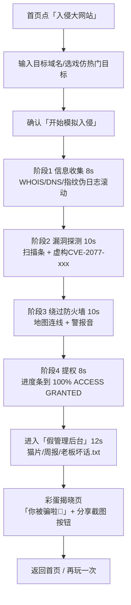
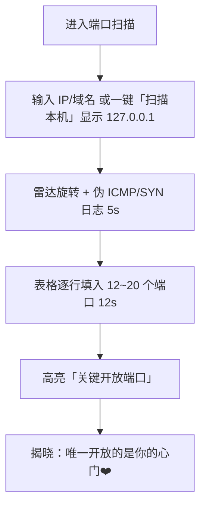
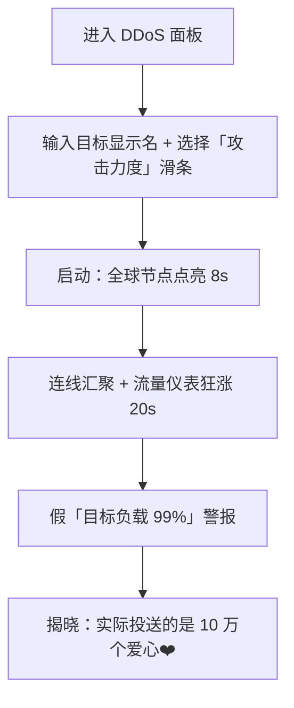

# 「黑客工具箱·搞怪版」产品需求文档（PRD）v0.1

| 项目 | 内容 |
|---|---|
| 文档版本 | v0.1（草案） |
| 日期 | 2026-10-17 |
| 负责人 | Tiger |
| 产品形态 | 纯前端、纯静态网页应用（PWA 可选） |
| 一句话定义 | 看起来像电影里的黑客神器，其实什么都不做的整蛊/娱乐模拟器 |

> ⚠️ **核心原则**：本产品所有"扫描、破解、入侵"效果均为**本地动画与随机文本**。产品**不发出任何真实网络请求**，**不教授任何真实攻击技术**，**不收集任何用户数据**。页面任何时刻都要有明显的『纯属娱乐，所有内容均为模拟』标识。

---

## 1. 产品定位与目标用户 / 场景

### 1.1 定位
一个"演技派"的假黑客模拟器：界面和流程模仿市面常见的黑客工具与影视作品中的黑客场景（终端绿字、进度条、滚动日志、世界地图攻击连线），视觉足够逼真以达到"唬人"效果；但每个流程最终都会以搞怪彩蛋揭晓"你被骗啦"，把紧张感转化为笑点。

### 1.2 目标用户

| 用户 | 画像 | 核心诉求 |
|---|---|---|
| 整蛊型用户 | 学生、上班族，喜欢和朋友互相恶搞 | 让朋友以为"电脑被黑了 / 我是黑客"，然后一起笑 |
| 内容创作者 | 抖音/B站/快手/小红书短视频博主 | 需要逼真的"黑客画面"做素材，可录屏、可竖屏 |
| 装X型用户 | 在网吧、教室、办公室想"看起来很厉害"的人 | 全屏运行，看起来在敲高深代码 |
| 技术圈玩梗用户 | 程序员、安全从业者 | 欣赏梗和彩蛋，转发到群里 |

### 1.3 典型场景
1. **整蛊朋友**：趁朋友离开把浏览器切到"你的摄像头已被接管"全屏页，朋友回来吓一跳 → 屏幕弹出"你被骗啦🤡"。
2. **拍短视频**：博主输入"某某大厂官网"，开启"入侵"流程，录下 30–60 秒的满屏绿字 + 进度条 + "ACCESS GRANTED"，结尾反转搞怪结局。
3. **装X**：全屏开启"黑客打字机"模式，随便敲键盘都会输出看起来很专业的伪代码。
4. **聚会/直播互动**：投屏玩"DDoS 面板"，观众喊目标，最后结局是"成功给对方发送了 10 万个❤️"。

### 1.4 非目标（明确不做）
- 不做任何真实安全工具、教学、靶场或 CTF 功能。
- 不做"恐吓勒索"式恶作剧（如伪造系统崩溃并诱导付款/拨打电话）。
- 不做账号体系、社交排行榜（v0.1 阶段）。

---

## 2. 合规与安全红线

以下为**不可妥协**的红线，任何功能评审、代码评审、内容评审都需逐条核对。

### 2.1 零真实网络请求
- **R1 – 零目标请求**：对用户输入的域名/IP/URL/WiFi 名/手机号等，**不得**发起任何 DNS 解析、HTTP(S)、WebSocket、ping、WebRTC、``/`<link>`/favicon 预取、`fetch`、`navigator.sendBeacon` 等请求。用户输入**只作为显示文本**。
- **R2 – 零第三方请求**：页面运行时不加载第三方 CDN、字体、统计、广告 SDK；所有资源（字体、音效、地图底图、图标）随静态包本地打包。
- **R3 – 技术兜底**：
  - 部署时设置 CSP：`default-src 'self'; connect-src 'none'; img-src 'self' data: blob:; media-src 'self' blob:; font-src 'self'; frame-src 'none'; form-action 'none'`。
  - 页面内加 `<meta http-equiv="Content-Security-Policy">` 同等策略（静态托管无法配响应头时兜底）。
  - 禁用 `<link rel="dns-prefetch/preconnect/prefetch">`；渲染用户输入时不得将其转为可点击链接。
  - CI 中加入自动化检查：E2E 测试运行完整流程，断言除首屏静态资源外**网络请求数为 0**。
- **R4 – 不访问敏感设备能力**："摄像头监控"模块**不调用** `getUserMedia`，画面为预制/程序生成的假画面；不读取剪贴板、地理位置、通讯录、蓝牙、真实 WiFi 列表。

### 2.2 不教授真实攻击技术
- **R5**：所有"命令""代码""日志"必须是**无可执行意义的伪代码/梗文本**，或刻意改写为无害版本。禁止出现可直接复制使用的真实攻击命令、payload、exploit 代码、真实工具的有效参数组合。
- **R6**：日志文本库建立"真实感但无效"的写作规范，例如 `inject --banana-mode=extreme`、`bypass firewall... using 3 cups of coffee`；文本库上线前需人工评审。
- **R7**：不提供任何"教程""原理讲解""下一步怎么做真的"等引导。

### 2.3 不用真实漏洞名误导
- **R8**：禁止使用真实 CVE 编号、真实漏洞名（如 Heartbleed、Log4Shell、EternalBlue 等）、真实恶意软件名、真实黑客组织名。
- **R9**：使用明显虚构的搞怪名称，例如 `CVE-2077-114514`、"薛定谔溢出漏洞""午睡提权漏洞""奶茶注入（MilkTea Injection）"。

### 2.4 不收集用户数据
- **R10**：无后端、无埋点、无 Cookie、无指纹。设置项（音效开关、主题）仅存 `localStorage`，可一键清除。
- **R11**：用户输入不持久化（刷新即清空），不上传。截图/录屏在本地生成，由用户自行下载/分享。
- **R12**：如后续需要统计（见开放问题），只允许自托管、无 Cookie、聚合级别的统计，且须单独评审并在页面告知。

### 2.5 虚构数据声明
- **R13**：所有"目标数据"（IP、端口、账号、密码、地理位置、摄像头画面、管理员姓名等）均为随机生成或虚构。
  - IP 使用保留/文档地址段（`192.0.2.0/24`、`198.51.100.0/24`、`203.0.113.0/24`、`10.x`）或明显搞怪的值（如 `127.0.0.1` "你自己家"）。
  - 账号/密码使用梗文本（`admin / 123456`、`root / iloveyou_mom`），不得生成看起来像真实泄露数据的内容。
  - 人名、地址、手机号为明显虚构（如"张三""火星市银河区 404 号""138-0000-0000"）。
- **R14 – 常驻标识**：全局常驻『纯属娱乐，所有内容均为模拟』角标，**不可关闭**；全屏模式与录屏/截图中同样保留（可缩小但不得隐藏、透明度≥60%）。
- **R15 – 结尾揭晓**：每个模块的流程结束必须出现彩蛋揭晓页，明确说明"刚才都是假的"。
- **R16**：首次进入展示一次性免责声明（3 秒可跳过）："本站所有效果均为本地动画，不会对任何网站、设备、网络产生影响。请勿用于欺骗、恐吓他人或违法用途。"

### 2.6 真实品牌名处理建议
用户可能输入"淘宝""微信""google.com"等真实品牌/域名，产品自身也可能想放"热门目标"。建议：
1. **产品内置内容中不出现真实品牌名/Logo**。"热门目标"使用谐音/戏仿名：如"桃宝网""微星（不是那个）""谷鸽 Gugle""企鹅帝国""某度"。
2. **不使用真实 Logo、配色组合、商标字体**；目标"官网截图"用通用线框图生成。
3. **用户自行输入的真实名称**：仅作为文本原样显示，不做识别、不加 Logo、不补全；揭晓页对任何目标统一输出搞怪结局，**不得生成"已获取 XX 用户数据 N 条"之类针对真实品牌的具体虚假事实**，改用通用梗（"已获取：管理员的午饭菜单"）。
4. 可选：对输入命中常见大品牌词表时，在流程中额外加一句"（目标名称仅作显示，本站没有触碰它）"。
5. 分享截图默认带水印"模拟娱乐·非真实入侵"，降低被断章取义传播为"XX 被黑"谣言的风险。

---

## 3. 功能模块清单

优先级定义：**P0** = MVP 必须；**P1** = 首个迭代；**P2** = 远期/视反馈。

### 3.1 核心"黑客"模块

| # | 模块 | 描述 | 搞怪点 | 优先级 |
|---|---|---|---|---|
| M1 | 入侵知名大网站（含拿后台权限） | 输入目标域名 → 信息收集 → 漏洞探测 → 绕过防火墙 → 提权 → 进入"管理后台"假页面 | 后台是"管理员的私人网盘"：猫片 × 3000、未写完的周报、"老板坏话.txt"；终局揭晓"你被骗啦" | **P0** |
| M2 | 端口扫描 | 输入 IP/域名 → 雷达动画 + 端口表格逐行刷出（端口/服务/状态） | 服务名为梗：`8080 奶茶外卖服务`、`6666 老板摸鱼通道`、`114514 神秘端口`；最后"唯一开放的端口是你的心门❤️" | **P0** |
| M3 | 密码爆破 | 字典动画 + 密码尝试计数狂飙 → "命中" | 字典内容是"密码123""我爱你""qwerty"等经典弱口令梗；命中密码永远是 `iloveyou` 或用户自己刚输入的昵称反转 | **P0** |
| M4 | DDoS 面板 | 地图上多点向"目标"连线，流量仪表盘狂涨，"节点数"飙升 | 实际在"攻击"的是一堆可爱表情包；终局"成功投送 10 万个爱心❤️，目标已被温暖淹没" | **P0** |
| M5 | WiFi 破解 | 扫描附近"WiFi"列表 → 选中 → 握手捕获动画 → 字典破解 | WiFi 名全是虚构梗（`隔壁老王的免费WiFi`、`家里没网别连`）；密码揭晓是"密码就写在路由器贴纸上啦（本页没有真的去看）" | **P1** |
| M6 | 监控摄像头 | 假摄像头画面网格 + 云台控制 + 夜视切换 | 画面是预制的办公室空镜/猫咪/鱼缸循环视频或 Canvas 生成噪声+时间戳；点"录音"弹出"对方正在说：今天中午吃什么？" | **P1** |
| M7 | 黑客打字机（装X模式） | 全屏终端，任意按键输出伪代码流水线，可调速度 | 偶尔输出"ERROR: coffee.exe not found"、"正在同步摸鱼进度 87%"；按 ESC 揭晓"你其实在打字练级" | **P1** |
| M8 | 社工库查询（假） | 输入手机号/邮箱 → 假泄露库命中动画 | 命中结果全是荒诞字段："最爱的奶茶口味""上一次说'在吗'的时间"；明确标注"纯属娱乐，无任何真实数据" | **P2** |
| M9 | 卫星定位追踪 | 地图上"定位"目标，卫星扫描圈 + 坐标跳动 | 最终定位到"火星市银河区 404 号"或"你家沙发（大概）" | **P2** |
| M10 | 勒索信伪造器（弱恐吓版） | 生成一张"你的文件已被加密"假锁屏图，用于整蛊截图 | **强约束**：不得要求付款、不得假拨号、不得假倒计时威胁；一键显示"只是整蛊图片，文件都好好的"；默认加大大的"FAKE"水印 | **P2（慎做）** |

### 3.2 全局能力模块

| # | 模块 | 描述 | 搞怪点 | 优先级 |
|---|---|---|---|---|
| G1 | 常驻娱乐标识 + 首次免责声明 | 角标不可关；首次进入弹窗 | 角标可切换文案变体（"本站不会黑任何人，包括你的前男友"） | **P0** |
| G2 | 主题与视觉引擎 | 经典绿字终端 / 赛博紫粉 / 红黑警报 三套主题 | 主题切换时有"切换次元"过场 | **P0** |
| G3 | 音效系统 | 键盘敲击、警报、进度完成、揭晓鼓点；可静音 | 揭晓时播"哇靠"/"你被骗啦"短语音（自制或授权素材） | **P0** |
| G4 | 全屏模式 | 一键全屏，隐藏浏览器 UI，适合整蛊/装X | 退出全屏时小彩蛋"任务取消，特工下班" | **P0** |
| G5 | 分享截图 / 本地录屏 | 截图自动加水印；可选浏览器 MediaRecorder 本地录屏并下载 | 水印随机变体："模拟娱乐·非真实入侵""Hack? Nah, Just Vibes." | **P1** |
| G6 | 结局图鉴 | 收集各模块彩蛋结局，本地解锁 | 全收集后解锁隐藏主题"白底黑字·正经版（其实更不正经）" | **P2** |
| G7 | 多语言 | 中/英界面 | 英文版梗同步翻译，保持本地化笑点 | **P2** |

---

## 4. MVP 范围（v0.1）

**目标**：2 周内可上线一版"足够唬人、足够好笑、绝对安全"的可玩网页。

### 4.1 必做（P0）
1. **壳子**：首页模块宫格 + 首次免责声明 + 常驻角标 + 三主题 + 音效开关 + 全屏。
2. **M1 入侵大网站（含假后台）** — 核心招牌流程，约 45–60 秒。
3. **M2 端口扫描** — 短流程约 20–30 秒，适合快速演示。
4. **M3 密码爆破** — 短流程约 15–25 秒，视觉冲击强。
5. **M4 DDoS 面板** — 地图连线，视觉最"电影"，约 30–45 秒。
6. **统一彩蛋揭晓页** + 本地随机数据生成器（假 IP/端口/日志/账号）。
7. **合规兜底**：CSP、零第三方请求、E2E 零网络断言、输入仅文本显示。

### 4.2 明确不做（MVP 砍掉）
- WiFi / 摄像头 / 打字机 / 社工库 / 卫星 / 勒索信（P1/P2）。
- 账号、后端、排行榜、评论、广告。
- 真实品牌 Logo、真实 CVE、真实工具名教程。
- 任何需要用户授权的设备 API（摄像头、麦克风、地理位置、蓝牙）。

### 4.3 成功标准（MVP）
- 陌生人 10 秒内能理解"这是在玩假黑客"。
- 完整跑完任意一个 P0 模块，朋友/观众有"吓一跳 → 大笑"的反应。
- DevTools Network 面板在操作全程除首屏静态资源外请求数为 0。
- Lighthouse 移动端 Performance ≥ 80；首屏可交互 < 2s（中端安卓）。

---

## 5. 核心模块详细交互流程

### 5.1 M1：入侵知名大网站（含拿后台权限）【P0 · 招牌】

**总时长**：约 50 秒（可加速 ×2）  
**界面主元素**：左侧伪终端日志、右侧阶段进度条、顶部目标名、底部常驻娱乐角标、世界小地图闪点。



**分步说明**

| 步骤 | 界面元素 | 时长 | 说明 |
|---|---|---|---|
| 1. 输入 | 大输入框 + 戏仿目标快捷芯片 + 「开始」按钮 | — | 输入仅显示；点击后不解析 DNS |
| 2. 信息收集 | 终端逐行输出伪 WHOIS/指纹；右侧出现随机文档段 IP | ~8s | 日志来自本地文本库 |
| 3. 漏洞探测 | 进度环 + 命中 `CVE-2077-114514 午睡提权漏洞` | ~10s | 禁止真实 CVE |
| 4. 绕过防火墙 | 小地图上 3–5 条弧线飞向目标；红色警报闪烁 | ~10s | Canvas/SVG 本地绘制 |
| 5. 提权 | 大号进度条 0→100%，最后 `ROOT ACCESS GRANTED` | ~8s | 可按空格加速（可选） |
| 6. 假后台 | 伪管理面板：侧栏「用户/订单/网盘」；点开网盘见猫片与梗文件 | ~12s | 数据全本地虚构 |
| 7. 揭晓 | 全屏砸出「你被骗啦🤡」、说明零真实请求、提供截图/再玩 | — | **必须出现，不可跳过** |

**彩蛋变体（随机一条）**
- "恭喜你成功入侵了……空气。"
- "管理员其实是一只橘猫，它不在乎。"
- "你获得的权限：把公司打印机设为默认双面打印。就这。"

---

### 5.2 M2：端口扫描【P0 · 短流程】

**总时长**：约 25 秒  
**界面主元素**：雷达扫描圆、端口结果表、终端旁白。



**分步说明**

| 步骤 | 界面元素 | 时长 | 说明 |
|---|---|---|---|
| 1. 输入 | IP/域名框；快捷「扫描本机」填 `127.0.0.1` | — | 不 ping、不扫真实端口 |
| 2. 雷达 | Canvas 雷达 + 嘀嘀音效 | ~5s | |
| 3. 填表 | 表格列：Port / Service / State；服务名全是梗 | ~12s | 例：`22 ssh-but-sleepy`、`443 https-of-feelings` |
| 4. 高亮 | 一行标红/标粉为"关键" | ~3s | |
| 5. 揭晓 | 「扫描完成：发现 1 个开放端口——你的心门❤️」 | — | 可分享 |

---

### 5.3 M4：DDoS 面板【P0 · 视觉担当】

**总时长**：约 40 秒  
**界面主元素**：世界地图、攻击源节点、连线、Gbps 仪表盘、节点计数器。



**分步说明**

| 步骤 | 界面元素 | 时长 | 说明 |
|---|---|---|---|
| 1. 配置 | 目标文本框 + 力度滑条（萌萌哒 / 有点凶 / 电影级） | — | 力度只影响动画速度与粒子数 |
| 2. 节点点亮 | 地图上随机城市点依次亮起，计数器 +N | ~8s | 城市坐标本地数据集 |
| 3. 连线汇聚 | 贝塞尔曲线飞向目标；仪表盘 Gbps 假数字 | ~20s | 数字为缓动函数，非真实流量 |
| 4. 警报 | 红色 Toast「目标负载 99%」 | ~4s | |
| 5. 揭晓 | 连线变成爱心雨；文案「成功投送 100,000 ❤️，目标已被温暖 DDoS」 | — | 音效切温馨 |

**彩蛋变体**
- "你的节点其实都是小区里的智能电饭煲。"
- "DDoS 解除：对方回了你一个贴贴。"

---

## 6. 全局设计规范要点

### 6.1 视觉主题
| 主题 | 主色 | 背景 | 字体 | 适用 |
|---|---|---|---|---|
| Matrix 绿（默认） | `#00FF66` | `#0A0F0A` | JetBrains Mono / 等宽本地字体 | 经典黑客感 |
| 赛博紫粉 | `#FF2D95` / `#7B61FF` | `#12081A` | 同上 | 短视频更抓眼 |
| 红黑警报 | `#FF3333` | `#140000` | 同上 | 整蛊惊吓场景 |

- 扫描线、CRT 微弱抖动、Bloom 光晕作为可选滤镜（性能弱设备自动关闭）。
- 进度条、按钮带轻微故障（glitch）动效，但不超过 200ms，避免引发不适。
- **常驻角标**：右下或左上，半透明深底 + 高对比白/绿字，字号 ≥ 12px（移动端 ≥ 11px），文案『纯属娱乐，所有内容均为模拟』；截图/录屏/全屏均保留。

### 6.2 音效
- 分层：UI 点击 / 键盘敲击循环 / 警报 / 完成叮 / 揭晓鼓点+语音。
- 默认**开启但音量 40%**；提供一键静音（记住到 localStorage）。
- 素材自制或使用可商用授权包，随静态资源打包，**不从 CDN 拉取**。
- 尊重系统"减少动态效果"/自动播放策略：无手势不自动出声。

### 6.3 全屏模式
- 使用 Fullscreen API；失败时降级为"沉浸 CSS"（隐藏本站导航）。
- 全屏时仍显示娱乐角标与退出提示（按 ESC）。
- 适合整蛊：进入模块前可勾选"直接全屏开始"。

### 6.4 分享截图 / 录屏
- **截图**：`html2canvas` 或 SVG foreignObject 方案，本地生成 PNG；强制叠加水印「模拟娱乐·非真实入侵」+ 角标文案。
- **录屏（P1）**：`MediaRecorder` + `canvas.captureStream`，仅本地下载 WebM/MP4，不上传。
- 提供竖屏 9:16 构图预设，方便短视频。
- 分享文案模板：「我刚"黑"进了 XXX（其实是假的）→ [站点链接]」。

### 6.5 文案与语气
- 过程中：半严肃半中二（"正在注入奶茶……成功"）。
- 揭晓时：明确、温柔、好笑，**避免羞辱用户**。
- 禁用真实恐吓、歧视、色情、血腥文案。

### 6.6 无障碍与舒适
- 尊重 `prefers-reduced-motion`：减弱闪烁与故障效果。
- 红黑主题默认关闭高频闪烁；提供"防眩晕模式"。
- 关键比满足可读性；关键操作可用键盘完成。

---

## 7. 非功能需求

### 7.1 部署与架构
- **纯静态**：HTML/CSS/JS（建议 Vite + 轻量框架如 Vue/Svelte/React 任一，或甚至原生），构建产物可扔 GitHub Pages / Cloudflare Pages / 任意静态桶。
- **无后端、无 Serverless、无数据库**。
- **离线可用（P1）**：Service Worker 缓存整包，断网也能整蛊。
- 产物体积目标：首屏 JS+CSS gzip 后 < 300KB；音效按需懒加载。

### 7.2 移动端适配
- 响应式：手机竖屏为短视频主力形态；平板/桌面双栏（终端+可视化）。
- 触控友好：大按钮、滑条；长流程提供"跳过动画看结局"（仍经过揭晓页）。
- 避免依赖 hover；全屏在 iOS Safari 做降级说明。

### 7.3 性能
- 动画优先 `requestAnimationFrame` + CSS transform；地图节点 ≤ 80 个同时连线。
- 低端机检测（硬件并发/内存启发式）自动降特效。
- 目标：中端安卓 60fps 为主；允许降到 30fps 保流畅。
- 内存：长时间挂机（装X模式）无泄漏；日志 DOM 做环形缓冲（最多 N 行）。

### 7.4 兼容性
- 最近两个大版本的 Chrome / Edge / Firefox / Safari；iOS 15+。
- 不依赖实验性 API；录屏等能力做特性检测与降级。

### 7.5 可测试性与合规验收
- 单元测试：随机数据生成器（IP 段合法性、无真实 CVE 词表）。
- E2E：Playwright 跑完 4 个 P0 模块，断言 `connect-src` 下无额外请求。
- 内容词表 lint：CI 扫描日志库，拦截真实 CVE/工具名黑名单。

### 7.6 隐私
- 无 Cookie、无第三方、无账号；隐私政策一页静态说明即可："我们看不到你，因为根本没有服务器在看。"

---

## 8. 待 Tiger 决策的开放问题（≤5）

1. **品牌与域名**：对外正式名用「黑客工具箱·搞怪版」还是更软的名字（如「假黑客模拟器」「Haxor Playground」）？是否注册独立域名，还是先挂 GitHub Pages 子路径？
2. **短视频分发策略**：是否在站内内置"一键导出 9:16 竖屏成片（含 BGM 与字幕轨）"作为 P1 重点，还是只提供原始录屏由创作者自行剪辑？
3. **恐吓边界**：P2 的「勒索信伪造器」是否直接砍掉，只保留温馨/搞笑结局线，以避免被用于恶意整蛊截图传播？
4. **统计与反馈**：MVP 是否完全零统计，还是允许接入自托管的无 Cookie 匿名 PV（如自建 Umami，且 `connect-src` 仅放行该域名）？
5. **商业化底线**：是否接受后期加入"赞助咖啡"/周边（贴纸、T 恤）入口？若接受，广告与外链如何与"零第三方请求"原则共存（例如仅在揭晓页提供可选跳转）？

---

## 附录 A · 模块优先级速览

```
P0（MVP）: M1 入侵大网站 | M2 端口扫描 | M3 密码爆破 | M4 DDoS 面板
           + G1 声明角标 | G2 主题 | G3 音效 | G4 全屏
P1       : M5 WiFi | M6 摄像头 | M7 打字机 | G5 截图录屏 | 离线 SW
P2       : M8 社工库 | M9 卫星 | M10 勒索信(慎) | G6 结局图鉴 | G7 多语言
```

## 附录 B · 修订记录

| 版本 | 日期 | 说明 |
|---|---|---|
| v0.1 | 2026-10-17 | 初稿：定位、红线、模块、MVP、三流程、设计与开放问题 |

---

*文档结束。实现时请以第 2 章红线为最高优先级；任何与红线冲突的"更真"需求一律拒绝。*
